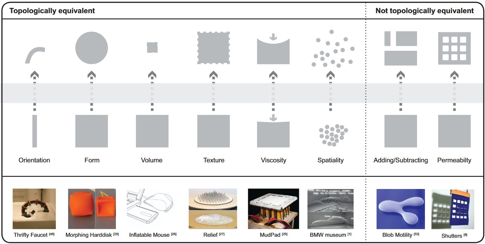
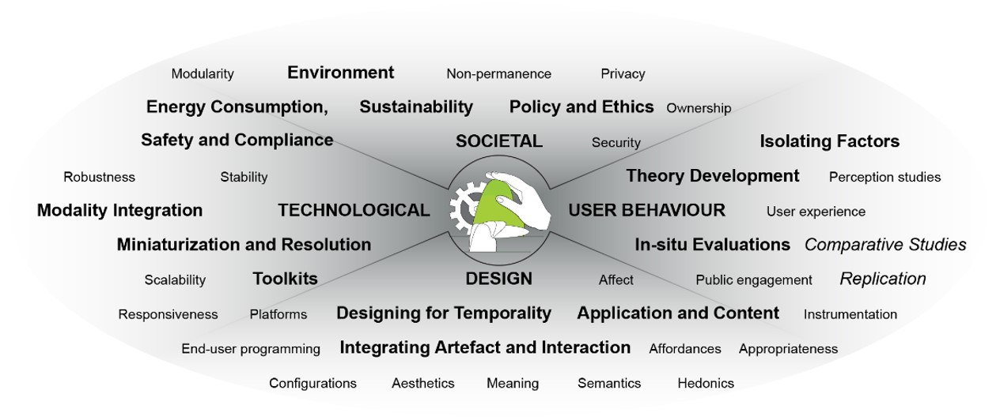

# Vision: Programmable Matter

The cinema and entertainment industries often present speculative visions of future technologies, serving as a bridge between scientific discourse and the collective imagination. For instance, many films and television series explore the concept of transformative materials and environments capable of dynamic reconfiguration, as illustrated in <Ref id="fig-scifi" />.

<Figure id="fig-scifi">

<FilmGallery>

<Film title="X-Men" year="2000" src="/assets/img/sci-scifis/x-men.jpg" gif="/assets/img/sci-scifis/x-men.gif">In **X-Men (2000)**, the surface of a round table morphs to form a miniature city model, aiding in the visualization of a collective battle strategy.</Film>

<Film title="Matrix Revolutions" year="2006" src="/assets/img/sci-scifis/matrix.jpg" gif="/assets/img/sci-scifis/matrix.gif">In **Matrix Revolution (2006)**, a artificial intelligence manifests itself by assembling a swarm of robots into a large humanoid face during its interaction with the protagonist.</Film>

<Film title="Big Hero 6" year="2014" src="/assets/img/sci-scifis/big-hero-6.jpg" gif="/assets/img/sci-scifis/big-hero-6.gif">In **Big Hero 6 (2014)**, the protagonist controls a swarm of microbots that assemble into various shapes and structures through thought alone.</Film>

<Film title="Avengers: Infinity War" year="2018" src="/assets/img/sci-scifis/avengers.jpg" gif="/assets/img/sci-scifis/avengers.gif">In **Avengers: Infinity War (2018)**, one of the protagonist’s suits, composed of nanobots, dynamically reconfigures to adapt to different combat scenarios.</Film>

<Film title="Man of Steel" year="2012" src="/assets/img/sci-scifis/man-of-steel.jpg" gif="/assets/img/sci-scifis/man-of-steel.gif">In **Man of Steel (2012)**, the interior of an alien ship materializes a physical key that the protagonist can subsequently remove and use.</Film>

<Film title="Suicide Squad" year="2021" src="/assets/img/sci-scifis/suicide-squad.jpg" gif="/assets/img/sci-scifis/suicide-squad.gif">In **Suicide Squad (2021)**, a character’s firearm physically reconfigures as components are attached or detached, enabling or disabling specific functions.</Film>

</FilmGallery>

<Caption>Interpretations of Programmable Matter in Science-Fiction</Caption>

</Figure>

In research, this speculative idea corresponds to what is known as *Programmable Matter* — a technological paradigm representing the convergence of computation and physical materiality, where algorithms are embedded within matter itself, enabling it to sense, compute, and reconfigure its own structure or properties. The conceptual roots of this vision can be traced back to  1965, when Sutherland envisioned a computer capable of "controlling the existence of matter" <Cite k="sutherland1965ultimate" />.

Today, this vision unites a range of research domains as shown in <Ref id="fig-programmable-matter-fields" />, including self-reconfiguring modular robotics within **Robotics** (e.g., <Cite k="yim2007modular" />), smart materials and metamaterials in **Materials Science** (e.g., <Cite k="pishvar2020foundations" />), and shape-changing interfaces within **Human–Computer Interaction** (e.g., <Cite k="rasmussen2012shape" />). Ultimately, these fields converge towards moving from discrete objects ("things") to continuous, reconfigurable materials ("stuff") as illustrated in <Ref id="fig-from-things-to-stuff" />.

<Figure id="fig-programmable-matter-fields">

<VennDiagram>

<Field position="left" title="Robotics" subtitle={"Self-reconfiguring\nmodular robots, …"} color="#57b7df" src="/assets/img/programmable-matter-fields/roombots.jpg">**Robotics**: [Roombots](https://www.youtube.com/watch?v=KY6QCDUngtk) is a self-reconfiguring modular robot <Cite k="sprowitz2010roombots" />.</Field>

<Field position="right" title="Material Sciences" subtitle="Metamaterials, …" color="#86c36f" src="/assets/img/programmable-matter-fields/auxetic-material.jpg">**Material Sciences**: [Auxetic Materials](https://www.youtube.com/watch?v=UL-OQYvQPO8) are metamaterials <Cite k="chen2021bistable" />.</Field>

<Field position="bottom" title="Human-Computer Interaction" subtitle="Shape-Changing Interfaces, …" color="#ef9b70" src="/assets/img/programmable-matter-fields/elevate.jpg">**Human-Computer Interaction**: [Elevate](https://www.youtube.com/watch?v=G4n-WHrbPiU&pp=ygU_RWxldmF0ZTogQSBXYWxrYWJsZSBQaW4tQXJyYXkgZm9yIExhcmdlIFNoYXBlLUNoYW5naW5nIFRlcnJhaW5z) is a shape-changing interface <Cite k="je2021elevate" />.</Field>

</VennDiagram>

<Caption>Multiple Research Fields Contributing Towards Programmable Matter</Caption>

</Figure>

<Figure id="fig-from-things-to-stuff">

<ThingsToStuff />

<Caption>**From Things to Stuff** <Cite k="le_goc_zooids_2016" />   Moving from discrete objects ("things") to continuous, reconfigurable materials ("stuff")</Caption>

</Figure>

# Research Field: Shape-Changing Interfaces

Nowadays, Graphical User Interfaces (GUIs) are ubiquitous in our societies offering flexibility and interactivity through graphical elements within a limited two-dimensional (2D) space (e.g., phones, tablets, laptops). While GUIs provide a high degree of malleability, allowing users to manipulate digital content with relative ease, they are constrained by the abstraction of the 2D screen. In contrast, Tangible User Interfaces (TUIs) <Cite k="ishii_tangible_1997,ishii_tangible_2008" /> leverage physical objects as interactive elements, enabling more natural and embodied interactions. TUIs support collaborative work, facilitate embodied thinking, sustain external memory, and allow parallel actions through spatially distributed interactions <Cite k="shaer_tangible_2010" />. By grounding interactions in the physical 3D world, TUIs leverage human cognitive, motor, and collaborative abilities that have evolved over millennia through hands-on experience with real-world objects. 

However, despite these advantages, TUIs are inherently limited in terms of malleability. Unlike GUIs, the physical properties of tangible objects -- such as position, orientation, shape, color, and transparency -- cannot be easily or dynamically modified through software, which restricts their adaptability and versatility in supporting a wide range of interaction scenarios. 
Without malleability, TUIs will remain perpetually outpaced by GUIs. Therefore, a key design challenge emerges towards the development of interfaces that combine the flexibility of GUIs with the embodied richness of TUIs.

Aligned with *Programmable Matter*, Shape-changing interfaces (SCIs) aim to blur the boundary between physical and virtual objects, combining the physicality of Tangible User Interfaces (TUIs) with the malleability of Graphical User Interfaces (GUIs) <Cite k="ishii_radical_2012,shaer_tangible_2010,strohmeier_sharing_2016" /> (see <Ref id="fig-radical-atoms" />): They are interactive devices performing physical transformations in response to user inputs or system events, enabling them to convey information, meaning, or affect <Cite k="alexander_grand_2018" />. 

<Figure id="fig-radical-atoms">

<ImageZones src="/assets/img/radical-atoms.jpg" alt="Three icebergs: GUI (Painted Bits), TUI (Tangible Bits) and Radical Atoms" hint="Point at a column (GUI, TUI or Radical Atoms) to read its explanation.">

<Zone title="GUI" label="Painted Bits" x={0} width={29.5}>A Graphical User Interface shows the digital information only through a screen, as if we looked at the surface of the water. We act on the forms below the surface with remote controls: a mouse, a keyboard or a touch screen.</Zone>

<Zone title="TUI" label="Tangible Bits" x={29.5} width={28.5}>A Tangible User Interface is like an iceberg: a part of the digital world comes out of the water into the physical world. This part is a physical manifestation of computation. We interact directly with the tip of the iceberg.</Zone>

<Zone title="Radical Atoms" x={58} width={42}>In Radical Atoms, all the digital information has a physical manifestation. We can interact directly with it, as if the iceberg had risen from the depths and shown its whole mass. Shape-changing interfaces move towards this vision.</Zone>

</ImageZones>

<Caption>**Radical Atoms** <Cite k="ishii_radical_2012" />   Shape-Changing Interfaces in the landscape of human-computer interaction</Caption>

</Figure>

## Purposes and Benefits

To help researchers and target user-groups see clear benefits in the development of shape-changing interfaces, <Cite k="alexander_grand_2018" /> explored the purposes and benefits from the literature. Five fundamental purposes for SCIs were identified, each illustrated in <Ref id="fig-sci-purposes" />:

* **Communicate Information** – conveying information through combinations of visual, haptic, and shape animation (see <Ref id="fig-sci-purposes-1" />).
* **Simulate Objects** – physically simulating real or imaginary objects (see <Ref id="fig-sci-purposes-2" />).
* **Adapt Interfaces** – adapting shape to specific interaction contexts (see <Ref id="fig-sci-purposes-3" />).
* **Augment Users** – augmenting elements of or within the user's body (see <Ref id="fig-sci-purposes-4" />).
* **Support Arts** – supporting aesthetic, sensorial, or entertainment goals (see <Ref id="fig-sci-purposes-5" />).

<Figure id="fig-sci-purposes">

<SubTabs>

**Communicate Information**: dynamic physical bar chart <Cite k="taher_exploring_2015" />

**Simulate Objects**: physical rendering of a 3D car model <Cite k="follmer_inform_2013" />

**Adapt Interfaces**: a reconfigurable game controller <Cite k="roudaut_cubimorph_2016" />

**Augment Users**: a sixth finger <Cite k="prattichizzo_sixthfinger_2014" />

**Support Arts**: kinetic garments <Cite k="berzowska_kukkia_2005" />

</SubTabs>

<Caption>Purposes of Shape-Changing Interfaces</Caption>

</Figure>

## Interaction Types

Rasmussen et al. <Cite k="rasmussen_shape_2012" /> identify three primary interaction types for shape-changing interfaces (See <Ref id="fig-sci-interaction-types-0" />):

* **No interaction** – shape change is used solely as system output (see <Ref id="fig-sci-interaction-types-1" /> and <Ref id="fig-sci-interaction-types-2" />).
* **Indirect interaction** – shape change occurs in response to implicit input (see <Ref id="fig-sci-interaction-types-3" /> and <Ref id="fig-sci-interaction-types-4" />).
* **Direct interaction** – shape change functions as both input and output. Within direct interaction, they distinguish two subtypes:

  * **Action and reaction** – users physically manipulate the interface’s shape, and the system responds with its own physical transformation (see <Ref id="fig-sci-interaction-types-5" /> and <Ref id="fig-sci-interaction-types-6" />).
  * **Input and output** – both the user and the system simultaneously manipulate the interface’s shape (see <Ref id="fig-sci-interaction-types-7" /> and <Ref id="fig-sci-interaction-types-8" />).

<Figure id="fig-sci-interaction-types">

<SubZones zones={[{ title: "No interaction", x: 0, width: 22.6, subs: [1, 2] }, { title: "Indirect interaction", x: 22.6, width: 25.8, subs: [3, 4] }, { title: "Direct interaction: action and reaction", x: 48.4, width: 21, subs: [5, 6] }, { title: "Direct interaction: input and output", x: 69.4, width: 30.6, subs: [7, 8] }]} hint="Point at a column of the diagram to see two examples of this type of interaction.">

Types of Interaction for Shape-Changing Interfaces

**No interaction**: 10,000 drones physically render a 3D model of Shenzhen (China) in a show by Damoda, September 26th, 2024 (<a href="https://www.youtube.com/watch?v=HJxM44npcJo" target="_blank" rel="noreferrer">video</a>)).

**No interaction**: 3D robotic billboard by The Coca-Cola Company (USA) at Times Square, New York, August 8th, 2017 (<a href="https://www.youtube.com/watch?v=7iUdFw9WfrU" target="_blank" rel="noreferrer">video</a>).

**Indirect interaction**: an actuated water faucet with creature-like motion that bends when users' daily water consumption exceeds a threshold <Cite k="togler_living_2009" />.

**Indirect interaction**: an actuated foldable table that reshapes itself to accommodate the number of nearby users<Cite k="gronbaek_kirigamitable_2020" /> (<a href="https://www.youtube.com/watch?v=sEQYKRLKJV0" target="_blank" rel="noreferrer">video</a>).

**Direct interaction (action and reaction)**: a shape-changing widget combining a knob and slider, allowing mode switching via a central button <Cite k="kim_knobslider_2018" /> (<a href="https://www.youtube.com/watch?v=Codcy5Ab8gU" target="_blank" rel="noreferrer">video</a>).

**Direct interaction (action and reaction)**: a kinetic toy that records user-manipulated shape transformations and plays back corresponding movements <Cite k="raffle_topobo_2004" /> (<a href="https://www.youtube.com/watch?v=UYn4GLs5veQ" target="_blank" rel="noreferrer">video</a>).

 **Direct interaction (input and output)**: users push against a pin-based shape display that simulates chest resistance during CPR training <Cite k="nakagaki_inforce_2019" /> (<a href="https://vimeo.com/326196792?fl=pl&fe=vl" target="_blank" rel="noreferrer">video</a>).

**Direct interaction (input and output)**: an auxetic surface actuated by a small number of motors simulates varying 3D curvatures as users move it across a table <Cite k="steed_mechatronic_2021" /> (<a href="https://www.youtube.com/watch?v=3oRe6TTEG-8" target="_blank" rel="noreferrer">video</a>).

</SubZones>

<Caption>Examples Illustrating Each Interaction Type</Caption>

</Figure>

## Shape-Change Properties

Rasmussen et al. <Cite k="rasmussen_shape_2012" /> identify eight primary types of shape transformations : **Orientation**, **Form**,
**Volume**, **Texture**, **Viscosity**, **Spatiality**, **Adding/Subtracting**, and **Permeability**. 
See <Ref id="fig-sci-shape-change-properties" /> for illustrations of these properties.

<Figure id="fig-sci-shape-change-properties">

<Caption>Types of shape transformations for Shape-Changing Interfaces</Caption>

</Figure>

## Architectures

To realize interfaces with physically reconfigurable geometry, researchers integrate combinations of sensors, hard or soft actuators, and smart materials into surfaces or volumes. These reconfigurable geometries can function as both input and output and are computationally controlled <Cite k="alexander_grand_2018" />.

Various actuated architectures for SCIs have emerged in recent years as illustrated in <Ref id="fig-sci-architectures" />. 
Each of these architectures enables the exploration of one or more types of shape transformations. This diversity is necessary, as no single interface can realize all possible transformations, highlighting the current absence of fully programmable matter.

<Figure id="fig-sci-architectures" cols={5}>

**Layers** (e.g., <Cite k="yim_animatronic_2018" />)

**Pin Array** (e.g., <Cite k="taher_exploring_2015" />)

**Sparse Dots** (e.g., <Cite k="le_goc_zooids_2016" />)

**Sparse Lines** (e.g., <Cite k="suzuki_shapebots_2019" />)

**Single Line** (e.g., <Cite k="nakagaki_lineform_2015" />)

**Voxels** (e.g., <Cite k="suzuki_dynablock_2018" />)

**Surfaces** (e.g., <Cite k="belke_mori_2017" />)

**Hub and Structs** (e.g., <Cite k="katsumoto_inside_2020" />)

**Ring Stack** (e.g., <Cite k="daniel_cairnform_2019" />)

**String Array** (e.g., <Cite k="engert_straide_2022" />)

<Caption>Actuated Architectures for Shape-Changing Interfaces</Caption>

</Figure>

# Research Agenda: Technology, User Behavior, Design, Ethics, Policy, and Sustainability

To advance SCIs, <Cite k="alexander_grand_2018" /> identified twelve grand challenges across four domains: *technology*, *user behavior*, *design*, and *policy, ethics, and sustainability*. <Ref id="fig-grand-challenges" /> illustrates these grand challenges.

<Figure id="fig-grand-challenges">

<Caption>**Grand challenges** for Shape-Changing Interfaces <Cite k="alexander_grand_2018" /></Caption>

</Figure>

## Technology

**Toolkits for Prototyping of Shape-changing Hardware.** There is a need to develop toolkits that facilitate the prototyping of shape-changing interfaces, which requires knowledge of complex electronics and mechanical engineering. This research aims to lower the implementation barrier by creating a standard platform for hardware prototyping, a cross-platform software layer, and tools for end-user programming, ultimately reducing the effort of classic interfaces by at least a factor of 10 in time and cost.

**Miniaturized Device Form Factors and High Resolution.** A significant challenge in shape-changing interfaces is the need for small, lightweight, and high-resolution actuators that can transition from stationary to mobile and wearable forms. Current electromechanical actuators often result in bulky setups, while user expectations demand high-resolution outputs. Addressing this challenge involves leveraging advancements in soft robotics and smart materials to create slimmer, more responsive actuation systems that can support a higher resolution of shape change.

**Integration of Additional I/O Modalities.** Today’s shape-changing interfaces need to integrate additional input and output modalities, such as high-resolution touch sensing and adjustable material properties, to realize their full potential. This can be achieved by incorporating off-the-shelf sensors and displays, as well as advances in flexible technologies that allow for conformal integration with actuators.

**Non-functional Requirements.** Energy consumption is a significant challenge in actuated systems, particularly in mobile or wearable solutions that must be self-contained, often relying on large batteries or having short battery life-spans. To address this, there is potential in systems design that reduces power consumption by offering (bi-)stable states, along with environmental energy harvesting and self-charging capabilities to ensure usability for at least a full day without recharging.

## User Behavior

**Understanding the User Experience of Shape-change.** We should seek to understand the user experience (UX) of shape-change, as evaluating its effectiveness presents unique challenges. These include isolating the effects of combined modalities and assessing the robustness of current systems for in-depth evaluations. By characterizing the value of shape-changing interfaces, we can identify beneficial domains and tasks, supporting their design and construction. This involves conducting comparative studies and isolating factors to deepen our understanding of user interactions with shape-change.

**Shape-Change Theory Building.** Behavioural sciences construct theories to integrate empirical results and make predictions, yet shape-change research lacks such theorizing. Developing theoretical statements that articulate how shape-change affects interaction could help predict user reactions and enhance our understanding of its usefulness.

## Design

**Designing for Temporality.** Shape-changing interfaces require temporal design, presenting challenges in translating behavioral sketches into actual designs due to the unique experiences users have with dynamic forms. While traditional design methods struggle to articulate these properties, inspiration from disciplines like dance and music can help develop techniques for designing and comparing temporal forms.

**Integrating Artefact and Interaction.** Designers of shape-changing interfaces must create devices that harmonize usability and aesthetics, engaging both the body and mind. This requires an understanding of theory, heuristics, and dynamic affordances, alongside the development of tools and methods that integrate artefact and interaction in the design process.

**Application and Content Design.** The design and implementation of applications and content for shape-changing interfaces present significant challenges, which can be categorized into four parts: when to apply shape-change, what shape-changes to implement, what applications to build, and how to design the content for those applications. It is crucial to develop frameworks and design principles that clarify the appropriate contexts for shape-change and establish consensus on shape-change semantics to avoid user confusion. Additionally, careful consideration of end-user content is essential, particularly for interfaces that utilize dynamic displays, necessitating the development of toolkits for content design across various formats.

## Policy, Ethics, and Sustainability

**Policy and Ethics.** Policy-makers face the challenge of creating legislation that ensures the safe and ethical operation of shape-changing interfaces without stifling innovation. Key issues include safety, security, content appropriateness, ownership responsibility, and the implications of non-permanency in transformations.

**Sustainability and the Environment.** Shape-changing interfaces pose sustainability challenges due to their demand for natural resources and recycling difficulties, but their morphing ability could reduce the need for multiple devices, ultimately lowering resource requirements. Researchers should focus on developing long-lasting, modular interfaces that support upgrades and interoperability to enhance sustainability.

# My Main Contributions

So far, I contributed three research projects in the field of Shape-Changing Interfaces that addressed some of these grand challenges.

## Expandable Illuminated Ring (2018)

In <Cite k="daniel_designing_2018" />, I presented the design and implementation of an expandable and stackable illuminated ring as a building block for ring-based shape displays. Ring-based shape displays are a type of shape-changing interface where the deformation or movement of the display is achieved through a system of rings. These rings can be mechanically actuated to create different shapes, surfaces, or structures in a controlled manner. We present the iterative design process of an expandable and stackable illuminated ring (<Ref id="fig-ring" />) -- the building block of a ring-based shape display.

This project contributed to the grand challenges of **Technology** (*toolkits for prototyping of shape-changing hardware, miniaturized device form factors and high resolution*).

<Figure id="fig-ring" layout={[[1,1,1],[1]]}>

Version 1

Version 2

Version 3

Version Finale

<Caption>Designing an Expandable Illuminated Ring to Build an Actuated Ring Chart</Caption>

</Figure>

## CairnFORM (2019)

In <Cite k="daniel_cairnform_2019" />, we introduced *CairnFORM*, (1) a stack of expandable illuminated rings for display that can change of axisymmetric shape (e.g., cone, double cone, cylinder). We show that axisymmetric shape-change can be used (2) for informing users around the display through data physicalization and (3) for unobtrusively notifying users around the display through peripheral interaction.

This project contributed to the grand challenges of **Technology** (*miniaturized device form factors and high resolution*) and **Design** (*integrating artefact and interaction, application and content design*).

<Figure id="fig-cairnform-1" layout={[[1],[1,1]]}>

A stack of expandable illuminated rings for display

Factors of the first study on data physicalization

Factors of the second study on peripheral interaction

<Caption>CairnFORM: a Shape-Changing Ring Chart Notifying Renewable Energy Availability in Peripheral Locations</Caption>

</Figure>

## CairnFORM² (2021)

In <Cite k="daniel_exploring_2021" />, we extend the understanding of the potential utility and usability of axisymmetric shape-change for display. We present (1) 16 new use cases for *CairnFORM*  (<Ref id="fig-sci-cairnform-2-1" />) and (2) a two-month comparative field study with *CairnFORM* in the workplace (<Ref id="fig-sci-cairnform-2-2" />). Compared with flat-screen animations, early results show that cylindrical shape-change animations keep a better attractiveness over time.

This project contributed to the grand challenges of **User Behavior** (*understanding the user experience of shape-change*) and **Design** (*application and content design*).

<Figure id="fig-cairnform-2" cols={1}>

Sixtheen use cases for ring-based shape displays

Two-month field study comparing ring-based shape displays and flat displays

<Caption>Exploring Axisymmetric Shape-Change’s Purposes and Allure for Ambient Display: 16 Potential Use Cases and a Two-Month Preliminary Study on Daily Notifications</Caption>

</Figure>

## ShyPins (2025)

In <Cite k="daniel_shypins_2025" />, we introduced ShyPins, a pin-based shape display that implements a safety strategy to protect users’ physical and psychological well-being by regulating pin motion based on user proximity (<Ref id="fig-shypins" />). Pin-based shape displays can cause discomfort or psychological harm when pins move forcefully against the user’s body; ShyPins addresses this by modulating actuation behavior as users approach. A user study showed that gradually reducing pin speed as users move closer is perceived as safer than abruptly stopping motion, while the perceived safety of motion pauses depends on user preferences in user-triggered actuation. Another study found that projecting user-centered stop zones improves perceived safety compared to pin-centered zones, and that users feel less safe when approaching moving pins than when pins move toward them.

This project contributed to the grand challenges of **Technology** (*integration of additional I/O modalities*), **Policy, Ethics, and Sustainability** (*policy and ethics*) and **User Behavior** (*understanding the user experience of shape-change*).

<Figure id="fig-shypins" layout={[[1],[1,1]]}>

ShyPins regulates pin motion to prevent the forcible (dis)appearance of tangible controls, mitigating psychological harm to users during scenarios like reconfiguring a tangible cockpit (top) and transitioning a physical bar chart (bottom).

Factors of the first study on perceived safety: the number of pin speed zones (a), the level of user body engagement (b), and the trigger of pin actuation (c).

Factors of the second study on perceived safety: the stop zone visualization (a), the pin matrix actuation density (b), and the shape-change interruption event (c).

<Caption>ShyPins: Safeguarding User Mental Safety From The Forcible (Dis)Appearance Of Pin-based Controls By Using Speed Zones</Caption>

</Figure>

# References

<References />
