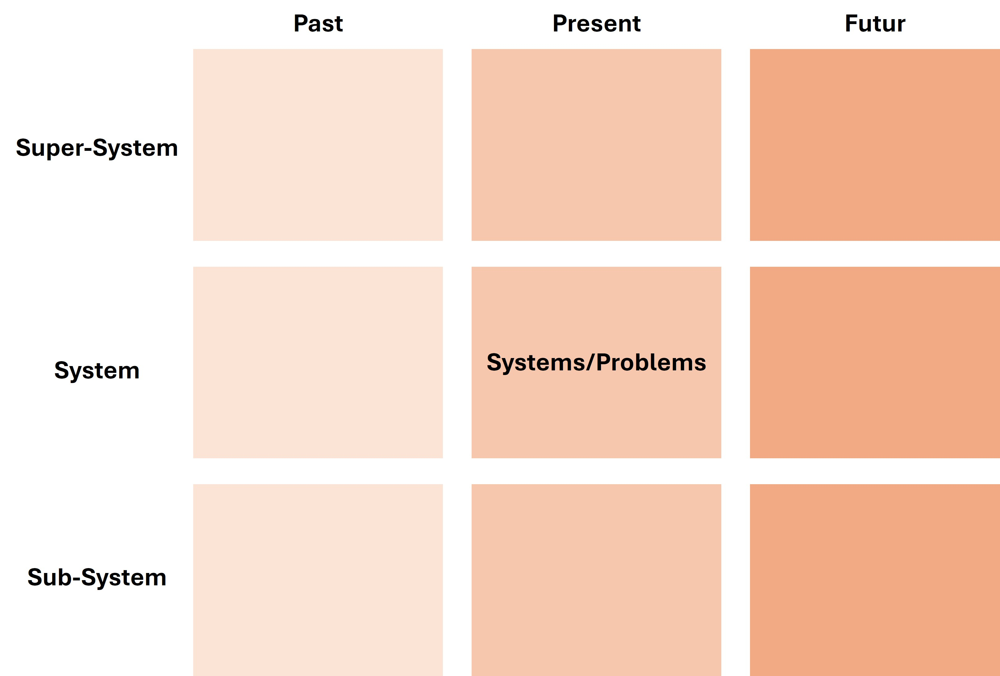

# Double Diamond Model

The Double Diamond model is a design process framework developed by the British Design Council. It consists of four phases divided into two diamonds: Discover, Define, Develop, and Deliver.

1. **Discover**: This phase involves researching and gathering insights about the problem or opportunity. It includes activities such as user research, market analysis, and stakeholder interviews to understand the context and needs.
2. **Define**: In this phase, the insights gathered during the Discover phase are analyzed and synthesized to define the core problem or challenge. This phase focuses on narrowing down the focus and creating a clear problem statement or brief.
3. **Develop**: The Develop phase is where ideas and solutions are generated and prototyped. It involves brainstorming, ideation sessions, and creating prototypes to explore different approaches to solving the defined problem.
4. **Deliver**: The final phase involves testing, refining, and implementing the chosen solution. It includes user testing, feedback collection, and finalizing the design for launch or production.

<Picture src="/assets/img/design-methods/double-diamond.jpg" id="doublediamond-container" width="80%">Double Diamond Model</Picture>

# Discover Phase

## Systematic Literature Review

PRISMA Checklist: [link](https://prisma-statement.org/PRISMAStatement/Checklist)

1. Review Planning: Plan review effort and training activities (e.g., tools, methods).
2. Question formulation: Define research questions (e.g, using PICOC).
3. Search strategy: Define review scope and search strings.
4. Selection process: Define inclusion and exclusion criteria.
5. Strength of evidence: Define what makes a high quality paper.
6. Analysis: Extract evidence from the selected papers.
7. Synthesis: Structure evidence in order to draw conclusions.
8. Process Monitoring: Ensure process is repeatable & complete.

### PICOC Method for Question Formulation

The PICOC method is used to formulate research questions in systematic literature reviews.
- Population: What is the population or domain of interest?
- Intervention: What is the intervention or technology being studied?
- Comparison: What is the alternative to the intervention (if any)?
- Outcome: What are the expected outcomes or effects?
- Context: What is the context or setting of the study?

### example
- Population: Software development teams
- Intervention: Agile methodologies
- Comparison: Traditional waterfall methodologies
- Outcome: Project success rates
- Context: Medium to large software development projects in the IT industry

final research question: "How do agile methodologies impact project success rates compared to traditional waterfall methodologies in medium to large software development projects in the IT industry?"

# Define Phase

## Discovery Matrix

The discovery matrix (matrice de découverte) is a two-dimensional table used to cross-combine two sets of variables to generate opportunities and reveal gaps. Empty cells represent "innovation windows" where new ideas or solutions can be explored.

<Picture src="/assets/img/design-methods/discoverymatrix.jpg" id="discovery-matrix-container" width="50%">Discovery Matrix</Picture>

## 5 Whys Method

The 5 Whys method is a problem-solving technique used to explore the root cause of an issue by asking "Why?" multiple times (typically five). The goal is to move beyond the symptoms of a problem to uncover the underlying cause. The process involves the following steps:

1. **Identify the Problem**: Clearly define the problem you are facing.
2. **Ask Why**: Ask why the problem is occurring and write down the answer.
3. **Repeat**: For each answer, ask "Why?" again and write down the new answer. Continue this process until you have asked "Why?" five times or until you reach the root cause.
4. **Analyze**: Review the answers to identify the root cause of the problem.

<Picture src="/assets/img/design-methods/5whys.jpg" id="5whys-container" width="50%">5 Whys Method</Picture>

# Develop Phase

## SCAMPER Method

The SCAMPER method is a creative thinking technique used to generate new ideas or improve existing products, services, or processes. The acronym SCAMPER stands for:

- **S**ubstitute: Replace a part of the product, service, or process with something else.
- **C**ombine: Merge two or more elements to create something new.
- **A**dapt: Modify or adjust an existing element to better suit the needs or context.
- **M**agnify/Minify: Change the size, scale, or quantity of an element.
- **P**ut to another use: Find new applications or uses for an existing element.  
- **E**liminate: Remove an element or feature to simplify or improve the product, service, or process.
- **R**earrange/Reverse: Change the order or orientation of elements to create a new perspective or solution.

<Picture src="/assets/img/design-methods/scamper.jpg" id="scamper-container" width="90%">SCAMPER Method</Picture>

## 6-3-5 Brainwriting Method

The 6-3-5 method is a structured brainstorming technique designed to generate a large number of ideas in a short amount of time. The name "6-3-5" refers to six participants, each writing down three ideas, and passing their ideas to the next person every five minutes. The process typically involves the following steps:

1. **Form a Group**: Gather six participants who will take part in the brainstorming session.
2. **Distribute Worksheets**: Provide each participant with a worksheet that has three columns for ideas and six rows for rounds.
3. **Set a Timer**: Set a timer for five minutes for each round of idea generation.
4. **Generate Ideas**: In the first round, each participant writes down three ideas related to the problem or challenge in the first row of their worksheet.
5. **Pass the Worksheets**: After five minutes, participants pass their worksheets to the person on their right.
6. **Build on Ideas**: In the next round, participants review the ideas on the worksheet they received and add three new ideas in the next row, building on or inspired by the previous ideas.
7. **Repeat**: Continue the process for a total of six rounds, with each participant contributing to each worksheet.
8. **Review Ideas**: After the final round, collect all the worksheets and review the ideas generated. Discuss and evaluate the ideas to identify the most promising ones for further development.

## 9 Windows Method

The 9 Windows method is a systems thinking tool used to analyze a problem or system across three levels of abstraction (super-system, system, and sub-system) and three time frames (past, present, and future). The method involves creating a 3x3 matrix with the following structure:

1. **Levels of Abstraction**:
   - **Super-System**: The larger context or environment in which the system operates.
   - **System**: The main focus or subject of analysis.
   - **Sub-System**: The components or parts that make up the system.
2. **Time Frames**:
   - **Past**: The historical context or previous state of the system.
    - **Present**: The current state or situation of the system.
    - **Future**: The anticipated or desired future state of the system.

\{#9windows-container width="50%"\} -->

# Interaction Design Methods

- https://www.csfieldguide.org.nz/en/chapters/human-computer-interaction/whats-the-big-picture/
- https://www.geeksforgeeks.org/system-design/design-process-task-analysis-hci/

 - 1. What are the new properties/features you propose to add to the system?
    - Constant pixel density during shape-change
 - 2. What are the potential benefits of adding these new properties/features to the system for the users?
    - existing information does not get distorted or pixelated during shape-change -> e.g., text remains readable, images/videos remain clear, charts/graphs remain interpretable
    - new information can be added during shape-change without affecting existing information -> e.g., annotations, highlights, overlays can be added seamlessly without disrupting the user's view of the original content
 - 3. What technical evaluation or user study can you do to validate and measure the benefits of these new properties/features?
    ????
    - assess text readability, image/video clarity, chart/graph interpretability during shape-change with constant pixel density -> does our technique holds up under various conditions?

# Deliver Phase

## MoSCoW Method 

The MoSCoW method is a prioritization technique used in project management and software development to help stakeholders categorize requirements or features based on their importance (used for **Minimum Viable Product (MVP)**). The acronym MoSCoW stands for:

- **M**ust have: These are critical requirements that are non-negotiable and must be included in the final product for it to be considered successful.
- **S**hould have: These are important requirements that are not critical but add significant value. They should be included if possible, but the project can still succeed without them.
- **C**ould have: These are desirable requirements that can enhance the product but are not essential. They can be included if time and resources permit.
- **W**on't have (this time): These are requirements that are agreed to be left out of the current project scope but may be considered for future iterations.

<Picture src="/assets/img/design-methods/moscow.jpg" id="moscow-container" width="50%">MoSCoW Method</Picture>

## Paper Writing

to do
